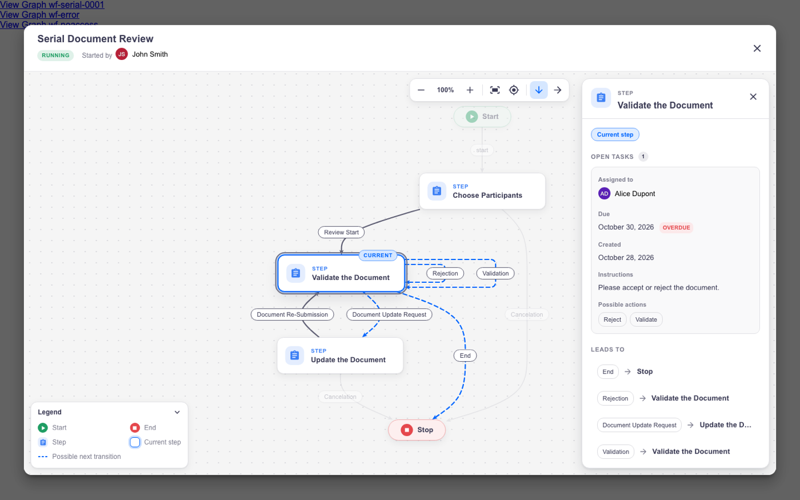
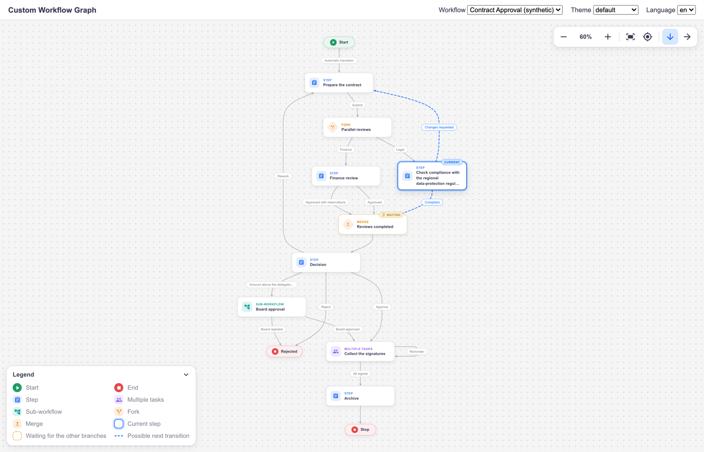
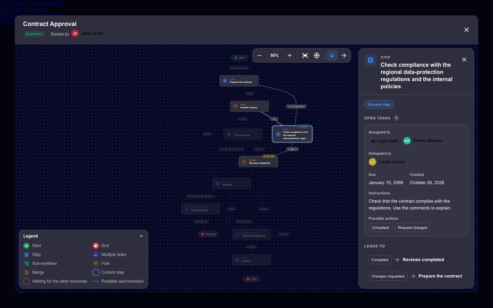
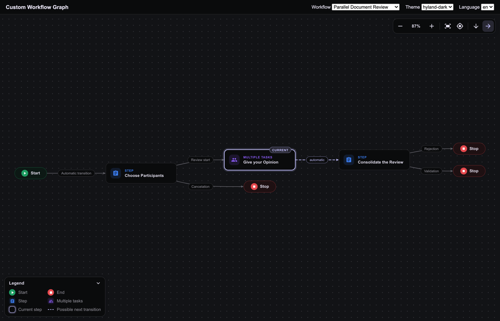
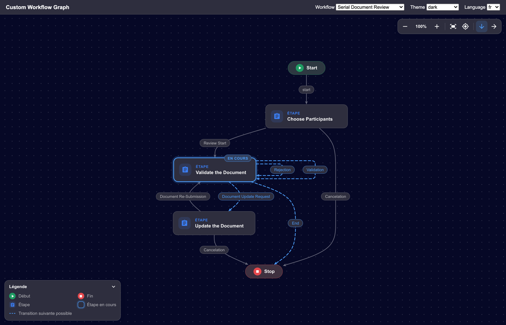
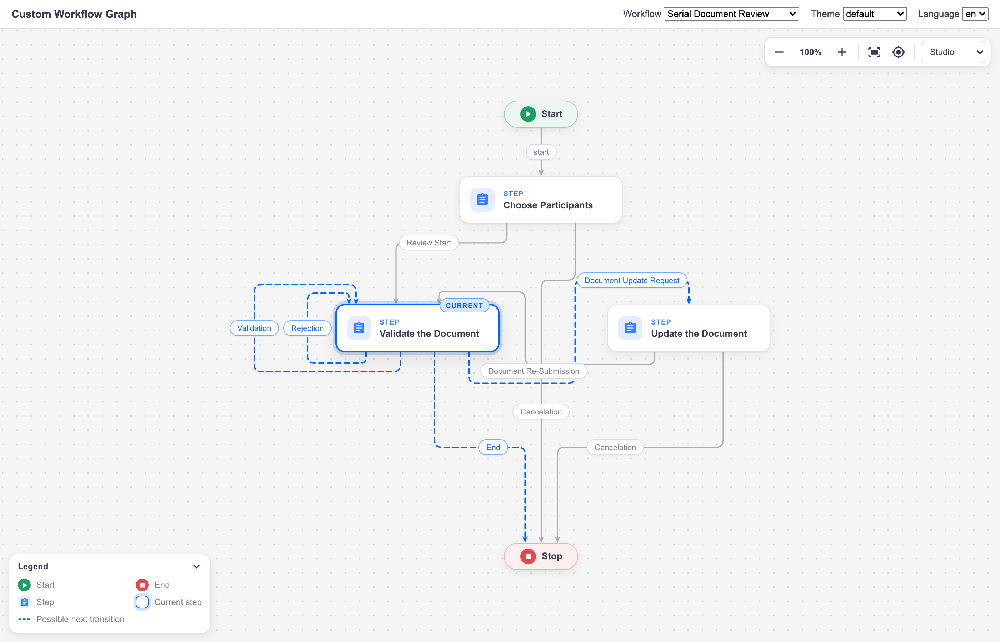
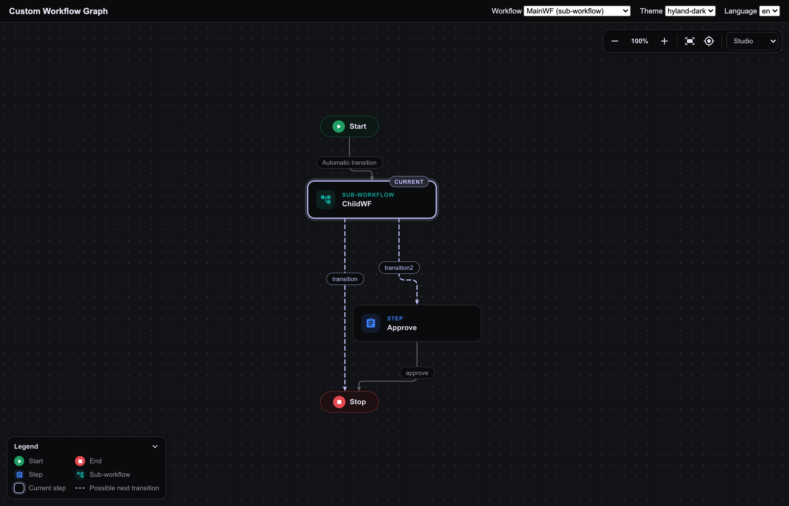

# Nuxeo Labs Custom Workflow Graph

> [!IMPORTANT]
> This plugin is **Work in Progress**. A start at having more modern workflow graph, with interactive/visual effects
> 
> It is not released on the marketplace. You can instead use [nuxeo-labs-workflow-graph](https://github/nuxeo-sandbox/nuxeo-labs-workflow-graph),
> that displays a modern graph, with no user interaction, no "switch to Studio coordinates", etc.

A modern replacement for the **"View Graph"** dialog of Nuxeo Web UI (Nuxeo LTS 2025): the graph of a running
workflow is laid out automatically (or as drawn in Nuxeo Studio), drawn with themed cards and smooth transitions,
highlights the current step(s) and the transitions that can follow, and shows the open tasks of the current step
(assignees, due date, instructions, possible actions).



| Automatic layout (fork, merge, loops, sub-workflow) | Dark theme, details of a step |
| --- | --- |
|  |  |
|  |  |

| "Studio" layout: positions and paths drawn in Nuxeo Studio | "Studio" layout, Hyland dark theme |
| --- | --- |
|  |  |

> The screenshots come from the development demo and the integration harness described below (mocked data, all
> persons are fictitious).

## Features

- **Two layouts**, selectable in the toolbar:
  - **Automatic** (default, layered, top to bottom or left to right): readable whatever the drawing made in Studio
    (overlapping boxes, outdated paths...). Loops back to a previous step are drawn as such; a transition looping
    on its own step is drawn around the step.
  - **Studio**: keeps the drawing made in Nuxeo Studio (positions of the steps, paths of the transitions),
    spread so that the bigger cards and the labels never overlap. Falls back to the automatic layout when the
    Studio positions cannot be used. See [Layouts](#layouts).
- **Modern rendering**: cards with an icon per kind of step (step, multiple tasks, sub-workflow, fork, merge),
  start/end pills, transition labels as chips, curved edges with arrow heads, dotted background.
- **Runtime state**: current step(s) highlighted (badge and pulse), outgoing transitions of the current step
  animated ("possible next transitions"), merge waiting for other branches, canceled steps dimmed.
- **Interaction**: pan (drag, wheel, arrow keys), zoom (pinch, Ctrl/⌘ + wheel, toolbar, `+` `-` `0`), fit
  (`f`), center on the current step (`c`, cycles when several steps are current), hover/selection highlights
  the neighborhood of a step, collapsible legend.
- **Details panel** (click a step): kind and state, "Leads to" / "Comes from" (click to navigate) and, for the
  current step, its open tasks: assignees and delegates, due date (with an "Overdue" flag), creation date,
  instructions, possible actions.
- **Header**: workflow title, state, initiator.
- **Themes**: follows the Web UI theme (default, dark, Hyland light and dark); every color can be overridden.
- **Translations**: English and French; labels coming from the workflow definition are translated as in Web UI.
- **Safe**: if the plugin is disabled or the custom graph cannot be drawn, Web UI's default graph is opened (see
  [When Web UI's default graph is used](#when-web-uis-default-graph-is-used)).

## How it works (front end only)

The analysis of Nuxeo LTS 2025 and Web UI showed:

- The data comes from `GET /api/v1/workflow/{id}/graph` (`WorkflowObject`, `JsonGraphRoute`): nodes with their
  Studio coordinates, title, kind and lifecycle state, transitions with label and the path drawn in Studio. This
  is enough for a better rendering, so **no server-side code is needed**.
- The default graph is the Web UI element `nuxeo-workflow-graph` (jsPlumb, fixed 880x720 canvas, absolute
  Studio positions, hard-coded colors). It is used by the document workflow bar (`nuxeo-document-info-bar`) and
  by the task view (`nuxeo-document-task`); both only call its `show()` method. It is not in a slot.
- The element cannot be redefined (`customElements.define` throws, and Web UI would then fail to load its lazy
  "elements" chunk). This plugin therefore **patches `show()`** once the element is defined: the plugin's dialog
  is created inside the element (where the default dialog lives) and the default `show()` is kept as a fallback.
  No Web UI file is modified.

The viewer only uses existing REST endpoints:

| Call | Used for | If it fails |
| --- | --- | --- |
| `GET /api/v1/workflow/{id}/graph` | the graph | the dialog closes and Web UI's usual error message is shown |
| `GET /api/v1/workflow/{id}` (`fetch-workflow: initiator`) | header | the header shows "Workflow" |
| `GET /api/v1/task?workflowInstanceId={id}` (`fetch-task: actors`) | open tasks | "The task details are not available" |

### Known limitations

These need data that the graph endpoint does not provide, and would require a server-side module:

- A step that has already run cannot be told apart from a step that never ran (the engine puts a node back in
  the `ready` state after it runs).
- The path actually followed is not shown (the engine does not keep the history of the transitions taken).
- Automation-only steps look like steps with a task (the graph does not tell whether a node has a task).

### When Web UI's default graph is used

"View Graph" opens Web UI's default graph instead of the custom one, as if the plugin was not installed, when:

- `org.nuxeo.web.ui.customWorkflowGraph.enabled` is `false` (see [Configuration](#configuration));
- the custom graph cannot be drawn (layout or rendering error);
- a node id is a reserved name, i.e. the name of a member of JavaScript's `Object.prototype`: `__proto__`,
  `constructor`, `toString`, `valueOf`, `hasOwnProperty`, `isPrototypeOf`, `propertyIsEnumerable`,
  `toLocaleString`, `__defineGetter__`, `__defineSetter__`, `__lookupGetter__`, `__lookupSetter__`. The layouts
  use node ids as object keys: such an id would break them and, for `__proto__`, alter every object of the Web UI
  page. The workflow is therefore rejected before any layout runs. Nuxeo Studio never generates these ids (its
  node ids look like `<workflow id>-<yyyyMMddHHmmssSSS>-<type>`); only a hand-written workflow model can contain
  one. Renaming the node is enough to get the custom graph.

In the last two cases a warning with the reason is written in the browser console, prefixed with
`[nuxeo-labs-custom-workflow-graph]`, for example:

```
[nuxeo-labs-custom-workflow-graph] The custom graph cannot be drawn, using the default graph
Error: Node id "__proto__" is a reserved name, the custom graph cannot draw this workflow
```

## Installation

Build with Maven (Java 21, Maven 3.8+):

```bash
mvn clean install
```

and install the package
`nuxeo-labs-custom-workflow-graph-package/target/nuxeo-labs-custom-workflow-graph-package-2025.1.0-SNAPSHOT.zip`:

```bash
nuxeoctl mp-install /path/to/nuxeo-labs-custom-workflow-graph-package-2025.1.0-SNAPSHOT.zip
```

Requires Nuxeo LTS 2025 with the `nuxeo-web-ui` package. After the installation (restart), the "View Graph" links
of the document page and of the task view open the new dialog.

## Configuration

Settings are `org.nuxeo.web.ui.*` configuration properties, exposed to Web UI as `Nuxeo.UI.config`:

| Property | Default | Description |
| --- | --- | --- |
| `org.nuxeo.web.ui.customWorkflowGraph.enabled` | `true` | `false`: Web UI's default graph is used, as if the plugin was not installed |
| `org.nuxeo.web.ui.customWorkflowGraph.layout` | `auto` | Layout used when the dialog opens: `auto` (automatic) or `studio` (as drawn in Nuxeo Studio). An unknown name falls back to `auto` |
| `org.nuxeo.web.ui.customWorkflowGraph.direction` | `TB` | Direction of the automatic layout: `TB` (top to bottom) or `LR` (left to right). Users can switch in the toolbar |
| `org.nuxeo.web.ui.customWorkflowGraph.allowLayoutSwitch` | `true` | Shows a layout selector (Automatic / Studio) in the toolbar; the choice is kept until the page is reloaded. `false`: only the configured layout is used |

To change a value, contribute the property again, for example from Studio (Configuration > XML Extensions):

```xml
<require>nuxeo.labs.customworkflowgraph.properties</require>
<extension target="org.nuxeo.runtime.ConfigurationService" point="configuration">
  <property name="org.nuxeo.web.ui.customWorkflowGraph.layout">studio</property>
</extension>
```

### Colors

The colors derive from the Web UI theme variables (`--nuxeo-text-default`, `--nuxeo-box`,
`--nuxeo-page-background`, `--nuxeo-primary-color`, `--nuxeo-focus-ring-color`...). They can be overridden with
CSS custom properties set on `html` (e.g. in a custom theme or a Studio style):

| Variable | Used for |
| --- | --- |
| `--cwg-current` | current step, its next transitions |
| `--cwg-color-start`, `--cwg-color-end` | start and end pills |
| `--cwg-color-step`, `--cwg-color-multi`, `--cwg-color-sub`, `--cwg-color-gateway` | kinds of steps (gateway = fork and merge) |
| `--cwg-waiting` | merge waiting for other branches |
| `--cwg-bg`, `--cwg-card-bg`, `--cwg-text`, `--cwg-edge`, `--cwg-grid` | canvas, cards, text, edges, grid |

## Keyboard and mouse

| Action | Mouse / touch | Keyboard |
| --- | --- | --- |
| Pan | drag the background, wheel (Shift + wheel: horizontal) | arrow keys |
| Zoom | pinch, Ctrl/⌘ + wheel, double-click on the background | `+` / `-`, `0` = 100% |
| Fit to screen | toolbar | `f` |
| Center on the current step | toolbar | `c` (repeat to cycle through parallel branches) |
| Switch layout (Automatic / Studio), direction (automatic layout) | toolbar | |
| Select a step | click | Tab to a step, then Enter or Space |
| Clear the selection, then close | close buttons | Escape |

Inside the dialog, keys are not propagated to Web UI's global shortcuts (`d`, `m`, `c`, `/`...).

## Architecture

```
nuxeo-labs-custom-workflow-graph-web/src/main/resources/
├── META-INF/MANIFEST.MF
├── OSGI-INF/
│   ├── deployment-fragment.xml          copies the web resources, merges the translations
│   ├── cwg-webresources-contrib.xml     registers the bundle HTML with Web UI
│   └── cwg-properties-contrib.xml       settings
└── web/nuxeo.war/ui/
    ├── i18n/messages.json, messages-fr.json
    └── nuxeo-labs-custom-workflow-graph/
        ├── nuxeo-labs-custom-workflow-graph-bundle.html   entry point (script order)
        ├── common/                      shared by all layouts
        │   ├── cwg-core.js              namespace, settings, i18n, layout registry, text measuring, model
        │   ├── cwg-geometry.js          curves, self-loops, bounds, fit and zoom
        │   ├── cwg-icons.js             inline SVG icons (Material Icons)
        │   ├── cwg-renderer-styles.js   CSS of the canvas
        │   ├── cwg-renderer.js          CWG.Renderer: drawing and interactions (framework-free)
        │   ├── nuxeo-labs-custom-workflow-graph-viewer.html   Polymer: data loading + details panel
        │   ├── nuxeo-labs-custom-workflow-graph-dialog.html   Polymer: dialog + header
        │   └── cwg-override.js          patch of nuxeo-workflow-graph.show()
        ├── layouts/
        │   ├── cwg-layout-auto.js       "auto" layout (dagre)
        │   └── cwg-layout-studio.js     "studio" layout (Studio positions and paths, own orthogonal router)
        └── vendor/
            └── dagre.min.js             dagre 3.1.3 (MIT), unmodified
```

Plain JavaScript and HTML imports, like Web UI add-ons built without a JS toolchain: no npm build is needed and
the Maven build only packages the files.

### Layouts

| Layout | Name | Description |
| --- | --- | --- |
| Automatic | `auto` | Layered layout computed by [dagre](https://github.com/dagrejs/dagre), top to bottom or left to right. Ignores the Studio positions (except for the initial order of the steps) |
| Studio | `studio` | Keeps the drawing made in Nuxeo Studio, adapted to the cards (see below). No direction: the drawing reads as in Studio |

#### The "studio" layout

The graph endpoint returns, for every step, the position of its box in the Studio workflow editor and, for every
transition, the path drawn in Studio. As verified in the Nuxeo, Web UI and Studio sources:

- the `x`/`y` of a step are the **top-left corner** of its Studio box, in pixels (Studio uses a 20 px grid). Studio
  boxes are 80x80 (step, multiple tasks, sub-workflow) or 40x40 (start, end, fork, merge);
- the `path` of a transition lists the ends of the segments of the orthogonal connector drawn by Studio (jsPlumb
  "Flowchart"), **relative** to the box spanned by its two anchors: the first point is on the bottom edge of the
  source, the last one is the top center of the target. Like Web UI, only paths of 3 points or more are used.

The cards of the viewer are much bigger than Studio's boxes (228 px wide, labels up to 170 px), so the drawing is
spread, not scaled:

- **Positions**: steps whose centers are less than one grid step apart are aligned in columns and rows. The Studio
  distances are kept as a minimum (very large gaps are reduced to 400 px), and only the cards that would overlap
  are pushed apart, on the axis that needs the smallest push. Steps linked by a transition going down are always
  separated vertically, to leave room for the transition. Left/right and above/below relations are kept. When many
  transitions or labels go between two rows, the gap is widened.
- **Transitions** leave a card by its bottom and enter it by its top, as in Studio. The path drawn in Studio is
  followed (orthogonal, rounded corners) when it can be mapped on the new positions without crossing a card;
  otherwise the transition is routed orthogonally around the cards, avoiding the lines already used. The ports are
  spread on the cards and ordered so that transitions do not cross when they leave or enter a card.
- **Self-loops** are drawn as in Studio, on the side used in Studio: out of the bottom, around the side, into the
  top. Several loops on one step are nested.
- **Labels** are placed along the transitions, preferably on a horizontal segment around the middle, never on a
  card or another label, and away from the arrow heads.
- **Fallback**: when the Studio positions cannot be used (all the steps at the same place, overlapping boxes...),
  the automatic layout is used instead, silently.

A 60-step workflow is laid out in about 0.4 s; very large workflows are discussed in `Possible-Improvements.md`.

#### Adding a layout

The layout engine is pluggable. A layout receives the model (nodes with their size, transitions with their label
size, Studio coordinates and paths) and returns positions:

```js
NuxeoLabs.CustomWorkflowGraph.registerLayout('my-layout', {
  labelKey: 'customWorkflowGraph.layout.myLayout',
  supportsDirection: false,
  isAvailable: () => true,
  compute(model, { direction }) {
    // model.nodes[i]: { id, kind, width, height, studio: { x, y }, ... }
    // model.edges[i]: { id, source, target, labelWidth, labelHeight, isSelfLoop, studioPath: [{ x, y }] }
    return {
      nodes: { [nodeId]: { x, y } }, // centers
      edges: { [edgeId]: { points: [{ x, y }], curve: 'basis' | 'rounded', labelPos: { x, y } | null } },
    }; // NuxeoLabs.CustomWorkflowGraph.geometry.normalize(model, result) computes width/height
  },
});
```

A new layout only needs a new file in `layouts/` and one `<script>` line in the bundle HTML; it is then selected
with `org.nuxeo.web.ui.customWorkflowGraph.layout` and listed in the toolbar selector.

## Development

The `dev/` folder is not packaged. Nothing is installed by the project: the browser tools use an existing
`node_modules` folder (e.g. the one of a Web UI add-on project) and an existing Chrome.

| Command | What it does |
| --- | --- |
| `node --test dev/test` | Unit tests (core, geometry, auto and studio layouts on the sample workflows: no overlapping nodes or labels, edges attached to their nodes, Studio coordinates and paths, fallback, reserved node ids...). Node 20+, no dependency |
| `python3 -m http.server 8765` then `http://localhost:8765/dev/demo/index.html` | Demo of the renderer with the sample workflows, layouts, themes, directions and languages (URL parameters: `wf`, `layout`, `theme`, `dir`, `lang`, `select`) |
| `node dev/tools/screenshots.mjs [filter]` | Renders every demo case (both layouts) in headless Chrome, fails on console errors or on a fallback of the studio layout, writes `dev/out/demo/*.png` |
| `node dev/tools/harness.mjs` | Integration test of the Web UI part without Nuxeo: real Polymer, nuxeo-elements and HTML Imports polyfill, the bundle loaded through `importHref` before `nuxeo-workflow-graph` is defined (as in Web UI), mocked REST API. Checks both "View Graph" entry points, the details panel, keyboard isolation, Escape, errors, permissions, the studio layout and the layout selector, the `enabled` switch and the fallback (layout failure, reserved node id) |

Environment variables of the browser tools:

| Variable | Description |
| --- | --- |
| `CWG_NODE_MODULES` | `node_modules` folder containing `puppeteer-core`, `esbuild`, `@polymer/*`, `@nuxeo/nuxeo-elements`, `@nuxeo/nuxeo-ui-elements`, `nuxeo`, `@webcomponents/html-imports` |
| `CHROME_PATH` | Chrome or chrome-headless-shell executable (default: Google Chrome on macOS) |
| `CWG_NUXEO_ELEMENTS_DIR` | Optional: sources of nuxeo-elements (`core/` and `ui/`) to test against a given Web UI version |

## Third-party code

- [dagre](https://github.com/dagrejs/dagre) 3.1.3, MIT License (`vendor/dagre.LICENSE.txt`), unmodified
  `dist/dagre.min.js` (SHA-256 `54a503e346f93ca0bb10abe7999587e037262935687aca45eb4e4b0f64bbb578`).
- Material Icons by Google, Apache License 2.0 (SVG paths in `cwg-icons.js`).

## License

[Apache License 2.0](http://www.apache.org/licenses/LICENSE-2.0)

## About Nuxeo

Nuxeo Platform is an open source Content Services platform, written in Java and part of Hyland. Data can be stored
in both SQL & NoSQL databases. Learn more at [hyland.com](https://www.hyland.com).
